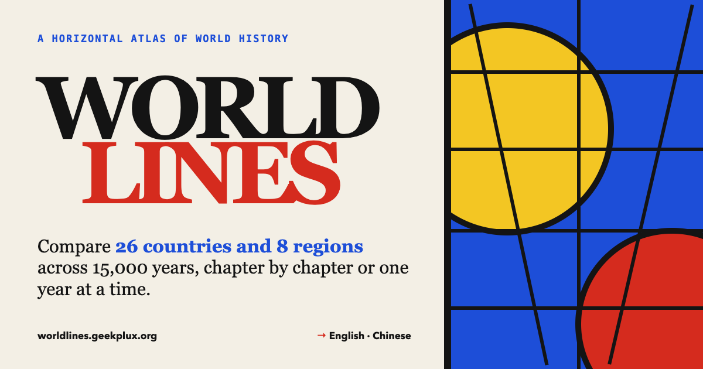

# Worldlines · 世界线

A bilingual (English / 中文) atlas of world history in the style of Mondrian. It lets you compare regions and countries side by side: chapter by chapter, across 15,000 years at once, or one year at a time.



**Live site:** https://worldlines.geekplux.com/ ([中文](https://worldlines.geekplux.com/?lang=zh))

- **Atlas.** Eight chapters, from the first settlements to today. Each lane is a **region** or a **country you choose**, so events on the same vertical line happened at about the same time. Country lanes also carry a strip showing which state held the place. You can filter by theme ("trace a thread"), zoom, and drag sideways.
- **Long view.** 26 places × 15,000 years, one block per state, dynasty, empire or colonial power. The countries you compare open into labelled rows, and the rest stay as thin strips. The states ruling in the frozen year are drawn in full colour.
- **Year slice.** Pick any year with the scrubber, a date mark or the ‹ › steps. Each place shows who ruled it, how far into that state's life the year falls, a to-scale strip of the states before and after, and nearby events. A side column lists what happened elsewhere at the same time.
- **Event panel.** Shows why an event mattered, "meanwhile, elsewhere…", who ruled each compared place that year, and the Wikipedia lead image (Commons files only).
- **Search** (<kbd>/</kbd>) covers events, countries and states. <kbd>Alt</kbd>+<kbd>←</kbd>/<kbd>→</kbd> changes chapter, and <kbd>Esc</kbd> closes panels.
- **Shareable links.** English is the default; `?lang=zh` opens the Chinese view (the browser's language is not used, and a visitor's own choice is remembered). The hash records the chapter, the open event, the year and the comparison set, e.g. `/?lang=zh#c=oceans&e=tokugawa&y=1603&cmp=china,japan,britain`.
- **No build step.** Plain HTML, CSS and JavaScript, with the content in three data files. A sibling of [Art-isms](https://artisms.geekplux.com/) and [Dialectica](https://dialectica.geekplux.com/).

## Sister atlases

Three bilingual atlases on one Mondrian grid, built the same way: static files with no build step, content in `{ en, zh }` data files, Cloudflare Workers, Google Analytics behind a consent bar. Each site's footer opens with a strip that links to the other two.

| | Atlas | What it maps |
| --- | --- | --- |
|  | [Art-isms · 艺术流派志](https://artisms.geekplux.com/) · [code](https://github.com/geekplux/artisms) | 40 art styles across 45,000 years, how each grew from the last, and three real works for each |
|  | [Worldlines · 世界线](https://worldlines.geekplux.com/) · [code](https://github.com/geekplux/worldlines) | 26 countries and 8 regions across 15,000 years, chapter by chapter or one year at a time |
|  | [Dialectica · 思辨谱](https://dialectica.geekplux.com/) · [code](https://github.com/geekplux/dialectica) | 72 schools and 204 thinkers across 8 traditions: who taught, read and argued with whom |

## Run it locally

```sh
python3 -m http.server 8000 --directory public
# then visit http://localhost:8000
```

`npx wrangler dev` also works. Event images load from Wikipedia, so they need a connection; without one, each panel shows a Mondrian plate instead.

## Project structure

```
public/                 everything that is deployed, and nothing else
  index.html            page skeleton, static copy, SEO tags, analytics setup
  assets/styles.css     all styles (paper, ink and De Stijl)
  assets/app.js         rendering, comparison, year slice, i18n, routing, consent bar
  data/core.js          chapters, regions, places, themes, polity kinds, learning notes
  data/polities.js      who held each place, from first states to today
  data/events.js        every hinge point on the atlas
  _headers              cache and security headers for Cloudflare
  robots.txt, sitemap.xml, og.png, favicon.svg, apple-touch-icon.png, favicon-48.png
scripts/check-data.mjs  validates the data, the asset stamps and the counts quoted in the page
scripts/stamp-assets.mjs  writes ?v=<content hash> into index.html
wrangler.jsonc          Cloudflare Workers Static Assets config
```

## Content model

Every piece of text is a `{ "en": "…", "zh": "…" }` pair. Years are integers, and negative years are BCE.

An **event** (`public/data/events.js`):

```js
{
  "id": "tokugawa", "chapter": "oceans", "year": 1603,      // year must fall inside the chapter
  "end": 1868,                                               // optional, for processes
  "date": { "en": "1603", "zh": "1603年" },
  "region": "east-asia", "place": "japan", "also": [],       // place may be null
  "theme": "state",                                          // state belief technology trade conflict society environment
  "title": { … }, "summary": { … }, "why": { … },
  "tags": "japan edo shogun 江户 幕府",
  "wiki": "Tokugawa shogunate"                               // English Wikipedia title, used for the image and "read more"
}
```

A **polity** (`public/data/polities.js`, keyed by place id):

```js
{ "s": 1603, "e": 1868, "n": { "en": "Edo shogunate", "zh": "江户幕府" }, "k": "s", "wiki": "Tokugawa shogunate" }
```

`k` is the kind of polity:

| `k` | Meaning |
| --- | --- |
| `s` | a home-grown state or dynasty |
| `d` | divided among rival states |
| `f` | ruled from outside: conquest, colony or mandate |
| `c` | an archaeological culture or era before or beside states |

Each place's polities are sorted and must not overlap. Gaps are allowed, and the last polity ends in 2026.

## Adding or correcting content

1. Edit the data file.
2. If you changed `assets/app.js` or `assets/styles.css`, run `node scripts/stamp-assets.mjs`.
3. Run `node scripts/check-data.mjs`; add `--warnings` to list gaps and region mismatches.
4. Open the page in both languages, at desktop width and at 390px.

CI runs the same check on every push and pull request.

## Deployment

The site is served at **https://worldlines.geekplux.com/** by **Cloudflare Workers Static Assets** with Workers Builds (Git integration). Every push to `master` runs `npx wrangler deploy`, which uploads `public/` as configured in `wrangler.jsonc`. There is no build command, and nothing outside `public/` (README, scripts, `.github`) is uploaded. The Worker name `worldlines` must match the Worker in the Cloudflare dashboard. The old `worldlines.geekplux.org` still serves the same Worker as a secondary domain; canonical tags, the sitemap and every link use `.com`.

`public/_headers` caches `assets/` for a year. That is safe because every reference to those files carries a content hash (`?v=…`) written by `scripts/stamp-assets.mjs`; `check-data` fails while a stamp is stale. `index.html` and `data/` are revalidated on every visit.

## Analytics

Google Analytics 4 (`G-10HB9ZHEKC`) runs on **worldlines.geekplux.com** (and the secondary `.org`) **only**, never locally or on preview URLs. It uses Consent Mode v2: until a visitor accepts in the consent bar, `analytics_storage` is denied, so GA receives cookieless pings and sets no cookies. Accepting allows analytics cookies, which are host-only (`cookie_domain: "none"`: set on `worldlines.geekplux.com` itself, with no domain attribute), so they are not shared with Art-isms, Dialectica or any other `*.geekplux.com` site; "Cookie settings" in the footer reopens the choice, and declining deletes any `_ga` cookies. Ads features stay denied.

Page views are not sent by `gtag("config")` (`send_page_view: false`). `app.js` sends them itself after the page has rendered, once on load and once after each language switch, so the title matches the language on screen; the location leaves out the hash, so chapter, event and year changes do not split the page reports. In the GA4 property, keep **Admin → Data streams → Enhanced measurement → Page views → Show advanced settings → "Page changes based on browser history events"** turned off: switching language rewrites the `?lang` parameter with `history.replaceState`, and that setting would log it as an extra page view (`send_page_view: false` does not stop them).

Besides page views, the site sends `select_content` events for the chapter, event, year, comparison set and language people pick, for the sister atlas they leave for (`content_type: "sister"`), and `search` with only the number of matches when the search closes (never the typed text). The setup is the inline script in `public/index.html`; the bar and events are in `public/assets/app.js`.

## Search engines

The page has a descriptive title and description in each language, a canonical URL per language with `hreflang` alternates (`/` for English, `/?lang=zh` for Chinese), Open Graph and Twitter cards (`og.png`), WebSite JSON-LD, `robots.txt` and `sitemap.xml`. A `<noscript>` block lists the eight chapters for crawlers that do not run JavaScript. The counts quoted in these tags are checked against the data by `check-data`.

## Caveats

Dates are conventional. States rarely begin or end in a single year. Modern country names are stable places to stand, not claims that those nations existed in the past. The selection is deliberately small: a learning scaffold, not a complete record.

## License

- Code (`public/index.html`, `public/assets/`, `scripts/`): [MIT](LICENSE)
- Written content in `public/data/`: [CC BY-SA 4.0](https://creativecommons.org/licenses/by-sa/4.0/)
- Event images are not part of this repository. Each one is loaded from Wikimedia Commons under its own licence.
